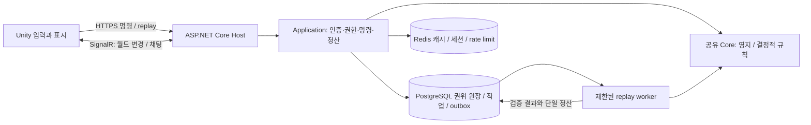

# ADR0077: SLG 첫 출시를 위한 C# 권위 서버

- 상태: **승인** (#556 병합, 사용자 stage② 로컬 시제품 구현 승인). 정식 배포·실계정·결제·월드 전투 구현 완료를 뜻하지 않는다.
- 날짜: 2026-10-30
- 연결: [#548](https://github.com/hyunlord/bs-mobile/issues/548)
- 결정 근거: 2026-10-30 사용자 결정. 직접 만드는 C# 서버와 월드맵을 첫 출시 범위에 포함한다.
- 조사 기준: main `21ff2530`. 수용 인원·주기·비용·보호 정책 수치는 모두 **[가설]**이며 부하·밸런스 검증 전이다.

## 1. 맥락과 변경되는 경계

[확정] 자원, 건설 시간, 행군, 전투 결과와 보상은 서버가 결정한다. 클라이언트는 입력·예측·표시를 담당하고 서버 버전으로 보정한다. 정식 계정은 PostgreSQL 저장을 사용한다. 기기 v6 저장은 개발·오프라인 시험용으로 보존하며, 파일을 업로드해 정식 계정의 자원·효과를 얻는 경로는 만들지 않는다.

기존 서버·PvP 제외 범위는 이번 SLG 설계 범위에서 대체한다. 결제·광고 SDK #122와 경제 확정값 #126 보류는 유지한다. [ADR0071](0071-account-estate-state-and-save-version-six.md)의 v6 로컬 codec을 서버 DB schema version으로 간주하지 않는다. [ADR0075](0075-independent-vassal-replay-format-eight.md)의 format8 구현 #528은 통합 의존성이다. 현재 main의 format1~7 실행·바이트·골든은 그대로 보존한다.

[#547](https://github.com/hyunlord/bs-mobile/pull/547)의 ADR0076/GDD14는 신규 계정 지도 시작만 남기고 개발용 옛 장원 저장 이관은 제외하는 수정이 예정되어 있다. `686bb85a`의 대장간·기록소·곡창·병영 효과 대응은 서버 신규 계정에도 적용할지 별도 정합 검토한다. 가신 상한·슬롯·도전 검증과 충돌하는 효과 중복 합산을 구현하지 않는다.

현재 순서인 가신 UI → #496 → 전투 UI → 영지 UI를 유지한다. 그 다음 이 ADR 승인 후 서버 시제품을 시작한다. 이 PR에서는 Unity·빌드·부하 시험·서버 구현을 하지 않는다.

## 2. 결정 제안: 모듈형 단일 서버

첫 배포는 Linux VM 한 대의 ASP.NET Core 호스트, 제한된 전투 검증 worker, PostgreSQL, Redis로 한다. 모듈 경계는 나누되 처음부터 마이크로서비스로 분산하지 않는다. worker는 프로세스를 분리하여 CPU·메모리·실행 시간 제한을 적용한다. 검증 폭주가 행군·로그인을 막지 않게 자원을 예약한다.



서버 호스트는 **.NET 10 LTS [제안]**로 시작한다. .NET 8 지원 종료가 2026-11-10으로 가까우며 .NET 10은 2028-11-14까지 지원된다([공식 지원 정책](https://dotnet.microsoft.com/en-us/platform/support/policy/dotnet-core)). 기존 Core의 `net8.0;netstandard2.1`, C# 9 계약은 변경하지 않는다. 같은 Core 프로젝트를 ProjectReference하고 서버용 참조 타깃을 명시·검증한다. netstandard2.1 빌드와 서버에서 선택된 빌드의 골든 비교를 관문으로 둔다. Core를 서버용으로 복사하거나 Unity DLL을 규칙 정본으로 사용하지 않는다.

| 구성 | 책임 | 권위가 아닌 것 |
|---|---|---|
| PostgreSQL | 계정·영지·자원 원장·건설·병력·행군·동맹·보호막·판 발급·정산·outbox | 클라이언트가 계산한 잔액 |
| Redis | 읽기 캐시, 접속·세션 캐시, rate limit, 온라인 구독 정보 | 자원 잔액·완료 여부·유일한 영구 세션 원장 |
| Core | 주입된 입력·시각·콘텐츠에 대한 정수 결정적 계산 | DB, 네트워크, 실제 시각 읽기 |
| Application | 권한, 트랜잭션, server clock adapter, 작업 순서, 보상 중복 방지 | 클라이언트 시계 신뢰 |
| worker | 고정 규칙 버전의 replay 재실행 및 자동 전투 계산 | 클라이언트 종료 해시만 비교 후 지급 |

Redis 소실은 재로그인·캐시 재구축으로 회복한다. 금전·자원 중복 방지는 Redis lock이 아니라 DB 제약·트랜잭션으로 보장한다. Redis 8은 RSALv2/SSPLv1/AGPLv3 선택 라이선스이며 BSD라고 가정하지 않는다. 도입 시 버전·선택 라이선스·운영 의무를 확정한다([공식 라이선스](https://redis.io/legal/licenses/)).

## 3. 저장·명령·시간 계약

명령 envelope는 accountId(인증에서 결정), commandId, expectedVersion, payloadVersion을 가진다. `(accountId, commandId)` unique와 결과 보관으로 재전송을 같은 응답으로 만든다. 계정/건설/행군 row version과 잠금을 사용하고, 여러 계정을 건드릴 때는 ID 정렬 순서로 잠근다. 자원 증감 원장과 상태·outbox를 한 트랜잭션에 기록한다. 네트워크 전달은 중복될 수 있지만 영구 효과는 한 번만 적용한다.

행군 작업·정산 작업은 PostgreSQL에 dueAt, sequence, entityId, rulesVersion을 보관한다. Redis sorted set은 가속 인덱스일 뿐이다. worker 재시작 시 미완료 작업을 복구하고 fencing/version 및 unique settlement로 중복 실행을 무해하게 한다. 캐시·SignalR 발행은 commit 이후 outbox로 한다. 연결 복구 시 sequence 누락을 감지해 서버 snapshot을 다시 받는다.

건설·보호막·채집은 서버 UTC deadline으로 계산한다. Core는 시각 I/O 없이 주입값만 받는다. 기존 `AccountEstate.Run`은 wall/monotonic delta 검사를 하므로 서버 재시작 후 process uptime을 그대로 전달하면 안 된다. 마지막 승인 UTC와 논리 monotonic을 DB에 저장하고, 검증된 elapsed를 양쪽 논리 관측에 주입하는 adapter를 둔다. 역행·큰 시각 점프는 지급 보류/제한과 경보 처리하며 임의로 보상을 늘리지 않는다. 첫 관측, 재시작, NTP 보정, 오프라인 상한을 별도 테스트한다.

오프라인 생산은 기존 Core 상한·건설 선행 조건을 보존한다. 완료 시점마다 생산 속도가 달라지면 이벤트 경계별로 계산하고, 방치 전체 시간을 최종 레벨 속도로 소급하지 않는다. 서버 장기 중단의 누적 작업도 `(dueAt, sequence, entityId)` 순으로 복구한다. DB schema migration과 replay 규칙 버전은 별도로 관리한다.

## 4. 월드맵: 첫 출시 범위와 처리 방식

[확정] 하나의 논리 월드 서버에서 아래 전부를 첫 출시 대상으로 한다. 여러 월드 간 이동·교차 서버 전쟁은 후속이다.

| 기능 | 서버 계약 | 클라이언트 표시 |
|---|---|---|
| 자원지 채집 | 출발 병력·적재량 예약, 도착 점유 경쟁, 채집/귀환/정산 상태 전이 | 서버 출발·도착 시각으로 보간 |
| 몬스터·거점 PvE | 대상·비용·seed 고정, 자동/직접 전투 경로의 보상 규칙 분리 | 대상 선택, 직접 판 진입 또는 결과 |
| 타 영지 정찰·공격 | 거리·대상·보호막·정찰 범위·병력·전리품 상한을 출발/도착에 재검사 | 공개 가능한 정찰 정보만 표시 |
| 보호막 | 시작/종료/공격 시 해제·재사용 정책을 서버 데이터로 결정 | 서버 deadline 카운트다운 |
| 연맹 생성·채팅 | 이름 중복·권한·가입, 차단·신고·속도 제한 | 소속 채널만 구독 |
| 도움 가속 | helper+construction unique, 도움 횟수·시간 상한, 완료와 경쟁 시 단일 정산 | 갱신된 완료 시각 |

[가설] 월드 512×512 타일, AOI chunk 32×32, 동시 접속 목표 1,000명/등록 계정 10,000개/진행 행군 5,000개를 **측정 목표**로 둔다. 판매 가능한 수용 인원 보장이 아니다. 한 지역에 몰린 경우도 별도 시험한다. 카메라 근처 chunk와 인접 여유만 구독하고 채팅·지도 델타의 크기·빈도·구독 수를 제한한다.

[크기 정합 r2 제안](../design/gdd/18-slg-world-map-proposal.md#21-첫-출시-크기-정합-r2-가설)은 GDD18·화면 #563의 초기 128×128을 이 ADR의 512×512에 맞춘다. 계정당 도시 1타일·등록 10,000개 기준 총면적 점유 3.81%는 배치 여유의 산술 근거일 뿐 부하 통과가 아니다. 오프라인 도시를 포함하는 등록 목표와 1,000 CCU는 다른 값이며, 실제 배치·AOI 집중 부하 검증은 별도다. 크기 정합안은 2026-10-30 사용자 승인되었으며 수치는 [가설]로 유지한다. 이 승인은 ADR 전체 아키텍처의 승인과 구분한다.

[가설] 월드 scheduler는 1초 주기이며, 전투의 30Hz Core tick과 다르다. 행군을 매 초 한 칸씩 전 계정 순회하지 않고 출발/도착 시각과 경로를 저장해 due event만 처리한다. 게임 규칙상 충돌·중간 취소가 필요한 지점은 명시적 이벤트로 예약한다. 같은 시각의 도착 경쟁은 영구 sequence와 entityId로 결정한다. tick 지연은 클라이언트 보간으로 감추되 서버 정산 시각·지연 지표는 숨기지 않는다.

보호막 활성화와 공격 도착, 채집지 경쟁, 연맹 탈퇴와 도움을 같은 권위 트랜잭션 순서로 판정한다. 도착 후 계산이 느린 전투는 예약된 battleId/snapshot으로 진행하고 결과가 나중 상태를 덮어쓰지 못하게 한다. 신규 보호 시간·병력 손실·약탈 상한은 [미정] 데이터이며 구현 전 규칙 설계가 필요하다.

## 5. Core 재사용과 PvP/PvE 경계

### 현재 가능한 재사용과 신규 규칙

| 근거 파일 | 확인한 현행 기능 | 서버에서 추가할 책임 |
|---|---|---|
| `core/src/SowSiege.Core/SowSiege.Core.csproj` | net8.0/netstandard2.1 공유 규칙 | 동일 소스 참조·교차 타깃 해시 검증 |
| `AccountEstate.cs` (`Run` 포함) | 건설·생산·수령·개방·elapsed 처리 | DB 원자성·권위 시각·동시성 |
| `ReplayCodec.cs`, `InteractiveSession.cs`, `MetaReplayContext.cs` | 입력 재생·메타 context 검증 | 계정 권리·입력 허용 목록·정산 |
| `MetaEngine.cs`, `MetaSaveCodec.cs` | 기존 ManorLevels 효과·v6 저장 | 신규 서버 계정 효과 연결·DB 버전 |

파일명은 Core 하위 구현을 가리키며 현행 기능을 서버 구현 완료로 보지 않는다. **군대 자동전투·행군·연맹 규칙은 현재 Core에 없다.** PvP는 승인된 새 순수 Core 하위 모듈로 병력/가신/영지 snapshot, seed, 정수 전투 결과를 계산한다. 기존 survivor Simulation이 이미 SLG 군대 전투를 제공한다고 가정하지 않는다. 기존 프로필 경로는 바꾸지 않고 새 콘텐츠·계약으로 opt-in한다. 피해·손실·보호 규칙은 후속 ADR/데이터 설계가 필요하다.

### 직접 플레이 PvE 검증

1. 서버가 `runId/accountId/worldTarget/seed/profile/rulesVersion/contentHash/snapshotHash/expiry`를 발급·저장한다. 병력·입장 비용·대상 예약은 서버 상태에서 확정한다.
2. 클라이언트는 이 snapshot으로 서바이버식 판을 진행하고 입력 replay를 제출한다. 네트워크 단절 시 재제출은 가능하지만 만료·대상 예약 정책은 서버가 판정한다. 판 중 획득한 계정 자원은 검증 전 잠정 표시다.
3. 서버는 크기·명령 수·틱 수·벽시계 대비 진행·권한·버전을 검사한다. 현재 codec이 받는 `SetInvulnerable`, `SetSpawnPermille`, `GrantLevel` 같은 개발 명령은 production admission에서 거절한다. `HostGrantReroll`, `HostRevive`는 서버가 발행한 소비/권리 기록과 대조한다.
4. 제한된 worker가 **서버 보관 콘텐츠·규칙 바이너리·snapshot**으로 Core를 재실행한다. 판 중 배포되어도 발급 버전을 유지한다. 검증 큐가 넘치면 새 판 발급을 제한하며 보상을 우선 지급하지 않는다.
5. 서버가 결과에서 보상을 계산해 runId unique settlement로 한 번 지급한다. 클라이언트 보상·해시·저장 파일을 신뢰하지 않는다. 실패/만료/재시도/중복 정산을 로그로 구분한다.

결정적 replay는 규칙상 가능한 실행을 확인할 뿐 실제 사람이 조작했거나 봇이 없다는 증거가 아니다. 자동 플레이·정보 노출·클라이언트 변조 대응은 별도 정책이다. FP01은 역사 회귀만, 가신 효과 비교는 wave라는 기존 결정을 유지한다. format8은 #528 통합 후 서버도 같은 snapshot/content hash/remainder 계약으로 검증한다.

## 6. 실시간 통신 선택

**[권고] HTTPS 명령·replay 업로드 + 자체 호스팅 ASP.NET Core SignalR**. SignalR Hub는 전달 계층이며 상태 원장이 아니다. Azure SignalR Service 구매를 뜻하지 않는다.

| 후보 | 확인 사실 | 이번 판단 |
|---|---|---|
| SignalR | WebSocket 우선, fallback transport와 JSON/MessagePack 지원. .NET 자동 재연결은 설정 필요, 최초 연결 실패는 별도 처리 | 월드 AOI·행군 델타·채팅 첫 후보. Unity 6000 IL2CPP/AOT·모바일 복귀는 시제품 관문 |
| gRPC streaming | HTTP/2 양방향 streaming 가능. gRPC-Web은 client/bidi streaming 제한 | 내부 RPC 확장 후보. 모바일 공통 연결 기본으로 확정하지 않음 |
| 순수 WebSocket | 직접 메시지 계약 구현 가능 | SignalR Unity 호환이 막힐 때 대안. 재연결·ack·버전·backpressure 구현 비용 증가 |

근거: [SignalR 개요](https://learn.microsoft.com/en-us/aspnet/core/signalr/), [.NET client 재연결](https://learn.microsoft.com/en-us/aspnet/core/signalr/dotnet-client?view=aspnetcore-10.0), [gRPC-Web 제약](https://learn.microsoft.com/en-us/aspnet/core/grpc/grpcweb?view=aspnetcore-10.0). 전송 수신 순서를 게임 규칙 순서로 쓰지 않으며, 인증·AOI 권한은 reconnect마다 재검증한다. 느린 수신자는 델타를 제한하고 snapshot 재동기화로 전환한다.

## 7. 로그인·결제 자리·운영

- Apple/Google의 서명·issuer·audience·expiry·nonce를 서버에서 검증하고 provider+subject를 계정 키로 사용한다. 이메일이나 client userId만으로 로그인하지 않는다. 플랫폼에 맞는 authorization code/PKCE 흐름과 키 회전을 사용한다([Apple 검증](https://developer.apple.com/documentation/signinwithapple/verifying-a-user), [Google 서버 검증](https://developers.google.com/identity/sign-in/web/backend-auth)).
- 게스트는 서버가 발급한 임의 인증정보로 만들고 안전한 기기 저장소에 보관한다. device ID 자체를 비밀번호로 쓰지 않는다. 계정 연결은 양쪽 소유권 증명과 unique provider identity를 요구한다. 자원 합산을 자동 허용하지 않는다.
- access token은 짧게, refresh token은 회전·해시 저장·폐기 가능하게 한다. 영구 세션 상태는 DB, Redis는 캐시이다. TLS, 권한별 rate limit, 재전송 방지와 운영자 MFA/RBAC를 둔다.
- #122 결제·광고 SDK는 계속 보류. `PurchaseVerification` 경계와 provider transaction unique, 환불/취소 원장만 설계한다. 실제 지급은 추후 서버 영수증 검증 성공과 DB 원자 정산 뒤에만 가능하다. 키·스토어 계정·상품 생성은 이번 범위 밖이다.
- 관리 도구는 계정 조회·제재·채팅 신고·복구·작업 재처리로 시작한다. 자원 조정은 사유·운영자·전후 값의 감사 원장과 별도 권한을 요구하며 DB 직접 수정 버튼은 두지 않는다.
- 비밀키·DB 접속 정보·실제 토큰은 저장소·로그에 금지. 배포 secret store/환경 주입, DB·Redis 비공개 포트, 최소 권한, 로그 개인정보 제거·보존 기한을 적용한다.
- 관측: command 지연/거절, scheduler lag, DB lock·pool, replay queue/CPU/실패 이유, 중복 정산, reconnect, 백업 신선도. 분석 SDK를 도입하는 것이 아니다.
- PostgreSQL base backup + WAL을 VM 밖 암호화 저장소로 보내 PITR한다. snapshot만으로 정산 원장 보호를 완료했다고 보지 않는다. [공식 PITR](https://www.postgresql.org/docs/current/continuous-archiving.html)에 따라 실제 복원 훈련을 관문으로 둔다. RPO 5분/RTO 2시간 [가설], 보관·삭제·복원 권한 분리.
- 단일 VM은 단일 장애점이다. 첫 제한 출시의 위험 수용이 필요하며 HA라고 표현하지 않는다. 배포는 새 판 발급 중지·진행 작업 drain·호환 schema 확장 후 교체, 이전 run용 검증 버전 보존으로 한다. DB 파괴 migration을 바이너리 rollback으로 되돌릴 수 있다고 가정하지 않는다.

## 8. 저장소와 개발·CI 제안

아래는 **예정 구조**이며 이 ADR에서 디렉터리·패키지·compose를 구현하지 않는다.

```text
server/
  src/SowSiege.Server.Host/           # HTTP/SignalR, composition
  src/SowSiege.Server.Application/    # commands, run admission, scheduling
  src/SowSiege.Server.Infrastructure/ # PostgreSQL/Redis/provider/clock
  src/SowSiege.Server.Contracts/      # versioned public DTO
  src/SowSiege.Server.Worker/         # bounded replay execution
  tests/                             # integration/fault/load contracts
  compose.yaml                       # local-only services, later implementation
core/src/SowSiege.Core/               # ProjectReference, 규칙 사본 없음
```

Core 내부 상태를 그대로 공개 DTO로 직렬화하지 않는다. Sim은 CLI 호스트이므로 서버가 Sim 프로세스를 매 판 실행하지 않는다. 콘텐츠 로딩 재사용이 필요하면 Host 공용 라이브러리로 최소 추출하고 Core에 파일 I/O를 넣지 않는다.

로컬 compose는 API/worker/PostgreSQL/Redis와 선택 관측 profile, 개발용 mock identity/receipt를 제공한다. mock은 production 설정에서 시작을 거부한다. `.env.example`은 가짜 placeholder만, 데이터 volume은 작업 소유권별로 분리한다. 기존 공유 Mac 야간 측정·잠금 계약을 지킨다.

CI는 GitHub hosted runner에서 경계 검사, 단위·DB 통합, 중복/장애 주입, 역사 replay/hash, DB migration 전진·복원 검사를 수행한다. 공개 저장소에 DGX self-hosted runner를 연결하지 않는다. Unity 실기 호환·실부하 시험은 별도 증거로 남기며 CI 성공으로 대체하지 않는다.

## 9. Nakama·PlayFab 비교와 비용

공식 자료 확인일 **2026-10-30**. 플랫폼 기능 부족이나 C# 미지원이라는 잘못된 이유로 배제하지 않는다.

| 대안 | 현재 기능·가격 근거 | 이번 직접 서버 결정의 이유 |
|---|---|---|
| Nakama OSS / Heroic Cloud | OSS Apache-2.0, 인증·저장·그룹·채팅·멀티플레이·구매 검증. 서버 runtime Go/TS/JS/Lua. Cloud는 관리 DB·백업·운영 제공; 동적 가격 계산기의 금액은 이번 조사에서 미확인 | 기존 C# Core를 그대로 실행하려면 별도 .NET 경계가 필요. 단일 C# 규칙·원장·scheduler 소유를 우선 |
| PlayFab | PAYG $0/월+사용량, Standard $99/월+초과량, Premium $1,999/월+초과량. C# Azure Functions 지원 | C# 실행은 가능하지만 영지 원장·월드 scheduler·replay worker의 직접 소유와 계량/서비스 의존 축소를 선택 |

근거: [Nakama 기능·라이선스](https://github.com/heroiclabs/nakama), [Heroic Cloud 가격](https://heroiclabs.com/pricing/), [PlayFab 가격](https://developer.microsoft.com/en-us/games/products/playfab/pricing/), [C# Functions](https://learn.microsoft.com/en-us/xbox/playfab/live-service-management/service-gateway/automation/cloudscript-af/quickstart). Heroic 페이지의 Satori $600를 Nakama 가격으로 사용하지 않는다. PlayFab Foundation은 자격 조건이 있어 모바일 프로젝트의 무조건 무료 범위로 보지 않는다([모드 설명](https://learn.microsoft.com/en-us/xbox/playfab/get-started/mode-overview)). PlayFab 공개 MPS VM 가격은 2026-11-01 평균 약 6% 인상 예정이며 위 플랜 기본료와 구분한다.

첫 서버 한 대 예산 예시(USD, 공식 가격 + 사용량 가설):

| 항목 | 월액 | 성격 |
|---|---:|---|
| Lightsail Linux IPv4 16GB / 4vCPU / SSD320GB / 전송6TB | $84 | 공식 bundle 가격, 선택 가설 |
| object storage 100GB / 전송250GB | $3 | 공식 bundle, 백업 규모 가설 |
| snapshot 80GB × $0.05/GB-month | $4 | 공식 단가 × 보관량 가설 |
| 소계 | **$91/월부터** | HA·세금·환율·초과 전송·도메인·운영 인건비 제외 |

[Lightsail 공식 가격](https://aws.amazon.com/lightsail/pricing/), [서울 리전 지원](https://docs.aws.amazon.com/lightsail/latest/userguide/understanding-regions-and-availability-zones-in-amazon-lightsail.html). 8GB/2vCPU $44 대안은 더 작지만 Core 검증·DB 동시 부하가 미측정이다. WAL·로그 보관·egress가 bundle을 넘으면 추가 비용이 발생한다. $91은 견적 하한 예시이지 1,000 CCU 보장 가격이 아니다. 직접 서버는 관리형 서비스 비용을 줄일 가능성 대신 온콜·보안·백업·장애 복구 인건비를 직접 부담한다.

## 10. 구현 단계와 승인 관문

| 단계 | 범위 | 완료 증거 |
|---|---|---|
| S0 ADR 승인 후 시제품 | 공유 Core, DB 명령/원장, 로그인 mock, server clock, replay worker | 기존 골든/crowd-411/FP01 동일; 중복 명령·서버 재시작·시각 역행·debug replay 거부 |
| S1 영지·계정 | 신규 지도 계정, 서버 생산/건설/방치, 실제 로그인 | 동시 요청·오프라인 상한·효과 대응/가신 상한·슬롯·도전 저장 검증 |
| S2 첫 출시 월드 | 채집·몬스터/거점 PvE·정찰/공격/보호막·연맹/채팅/도움 | 동일 도착 경쟁·보호막 경쟁·중복 도움·worker crash·악성 replay·reconnect 검증 |
| S3 출시 관문 | 부하·운영·모바일 연결·복원·관리 도구 | 목표 CCU/행군/집중 AOI 부하, queue/지연/메모리 표, restore RPO/RTO, IL2CPP 실기 |

월드맵 기능을 S2에 둔 것은 출시 후로 미루는 뜻이 아니다. 첫 출시 전에 S0~S3를 모두 검증한다. #122 결제 구현은 별도 승인 때만 추가한다.

관문에는 PostgreSQL commit 직전/직후 종료, outbox 발행 후 종료, Redis 유실, 검증 worker timeout, 배포 중 구버전 run 제출, 동일 run 동시 정산, 계정 연결 경쟁, 타 계정/타 연맹 권한 우회와 초대형 replay를 포함한다. 기존 format1~7은 서버 블록 없이 같은 바이트·경로·종료 해시여야 한다. PvP 신규 규칙이 역사 경로 변경을 요구하면 구현을 멈추고 별도 승인을 받는다.

남은 결정: 군대 전투 규칙·손실/약탈·보호막 정책, 출시 지역/개인정보 보존, 계정 연결 충돌 처리, 실제 CCU와 비용, SignalR Unity 실기 적합성, Redis 라이선스 선택. ADR의 기술 권고와 가설은 이 항목의 검증 완료를 의미하지 않는다.

## 11. 최초 ADR PR의 검증 상태 (역사 기록)

문서·공식 자료 조사와 현행 코드 읽기만 수행한다. 서버·Unity·모바일·부하·결제·복원은 **NOT_RUN**이다. 구현 파일·데이터·Core·저장 형식·리플레이·역사 해시는 수정하지 않는다. PR은 초안으로 유지하고 사용자 승인 전 병합하지 않는다.


## 12. 승인된 stage② 구현 경계 (#575, 2026-10-30)

이번 시제품은 위 S0의 일부인 신규 계정 → 영지 명령 → 재접속만 구현한다.
replay worker·실로그인·월드맵·PvP·개발 기기 저장 이관은 다음 단계다.

- server/global.json에서 .NET10을 고정하고 root SDK8·Core 두 타깃은 유지한다.
- core/src/SowSiege.Content는 기존 Sim의 JSON parser와 의미 검증을 소유한다.
  Sim 공개 API/full validation은 유지하고 서버는 catalog 내부 의미 검증과 기존
  AccountEstate.Validate를 호출한다. 콘텐츠/아트 외부 참조 검증은 기존 Sim/CI가
  담당한다. 파일 bytes를 한 번 읽어 parse와 content hash에 같이 사용한다.
- CompatSim은 공유 parser 소스를 link하며 기존 netstandard2.1 Core DLL을 그대로
  참조한다. Content 프로젝트를 참조하여 net8 Core가 섞이는 방법은 쓰지 않는다.
- PostgreSQL이 상태·인증·시계·멱등 응답을 소유한다. 계정 row lock 아래 Core의
  거부 결과도 시간 경과 상태와 함께 저장한다. Redis는 disposable presence 힌트다.
- 신규 계정은 r8 설정이다. 기존 v6 codec은 내부 직렬화에만 쓰며 client blob을
  받지 않는다. DB schema version은 별도로 확인하고 미래 버전을 거부한다.
- Development와 명시적 prototype 설정이 모두 있어야 호스트가 시작한다. Compose
  HTTP/테스트 DB 포트는 loopback만, Redis는 내부망만 사용한다. 공개 배포 금지.

실제 Compose 재시작 관문이 끝나기 전에는 완료로 보고하지 않는다. 절차와 실행
상태는 [서버 stage② 런북](../runbooks/server-stage2.md) 및 #576에 기록한다.

## 13. 개인 개척전 리플레이 정산 시제품 보강 (#593, 2026-10-30)

§10의 1~5단계 중 개인 대체 판(GDD17 §3, 초안 `contracts.personalFallback`)만 먼저 구현한다. 월드 대상 예약·병력 N/K·귀환 정산·SignalR·별도 worker 프로세스는 다음 단계다.

- **발급:** `research` 분야 `start-expedition {proofId, resource}`. runId는 발급 commandId, seed는 처리기 밖 서버 키 HMAC(계정, 판 순번)이다. 만료 시각(설정, 기본 1시간)을 high-watermark UTC로 고정한다. 계정당 열린 판 1개. 병력·연구·수집 영웅·입장 비용을 요구하지 않는다.
- **제출·재실행:** `POST /v1/runs/{runId}/replay`(바이트, 설정 상한 기본 4MiB). 서버는 리플레이 헤더 옵션이 발급한 옵션(seed, 기본 영웅·영지, data tree hash, 프로필)과 **정확히 같아야** 하고, 일반 조작 명령만 허용한다(무적·레벨 부여·생성량·호스트 보상 명령 거부). 공유 Core `ReplayRunner.Verify`로 결정적 재실행해 체크포인트·종료 해시를 확인한다. 재실행은 계정 트랜잭션 **밖**에서, 동시 실행 수와 벽시계 시간 상한(설정, 기본 1개·30초)으로 묶는다. Core 재실행은 중단할 수 없으므로 시간 초과 뒤에도 끝날 때까지 슬롯을 점유한다.
- **정산:** 검증 판정만 내부 조작 `settle-expedition`으로 공통 writer에 1회 커밋한다. 공개 `/v1/account/commands`로는 이 조작을 보낼 수 없다(400). 판 상태가 `open`일 때만 정산하고 이후 제출·동시 제출은 `already-settled`로 끝나 재지급하지 않는다.
- **판정별 처리:** 검증 성공 + 프로필 종료(생존)만 목표 달성으로 보고 탐사 증명 1개와 선택 재료 `personalFallback.materialRewardCap`을 지급한다. 사망·중도 종료는 검증 성공이지만 보상 0이다. 위조·불일치·형식 오류·디버그 명령은 시도 횟수를 쓰며 설정 횟수(기본 3) 뒤 `failed`. 만료된 판은 `expired`.
- **실제 플레이 시간(GDD15 즉시 수령·무한 반복 금지):** `제출 시각 − 발급 시각 ≥ 종료 틱/tickRate − 허용 오차(설정, 기본 2초)`가 아니면 Core 재실행 전에 `too-early`로 거절하고 기록하지 않는다. 종료 틱을 줄여 속이면 재실행의 종료 해시 불일치로 거절된다. 공개 Core로 리플레이를 오프라인 생성해 발급 직후 제출하는 반복 수령을 막는다.
- **검증 자리 독점 방지:** 판(계정당 열린 판 1개)마다 마지막 제출 시각을 기록하고 설정 간격(기본 10초) 안의 재제출은 재실행 전에 `submit-too-soon`. 서버 예산 시간 초과는 시도 횟수를 쓰지 않지만 판당 상한(설정, 기본 3회)을 넘으면 `verify-budget-exhausted`로 판을 닫는다.
- **지급량 예약과 보관:** 발급 때 지급량을 확정한다: `min(materialRewardCap, pendingMaterialCap − 이 분야에서 아직 보관 중인 양)`(둘 다 데이터, [가설] 60/60). 0이면 `issued-proof-only`(재료 0 · 증명만). 정산은 약속한 양을 `DomainCredit`으로 내고, 지갑에 들어가지 못한 양은 공통 보관함(#599, 발생 시각 순 지급)이 맡는다.
- **경계:** Core·리플레이 형식·골든 해시는 바꾸지 않는다. 서버는 Sim의 정본 `ContentLoader`(카탈로그, data tree hash)를 읽기 전용으로 참조한다. 시제품의 "목표"는 생존이며, 밭 경계 등 목표별 판정은 Core에 목표 개념이 생긴 뒤 별도 결정이다. 결정적 재실행은 사람이 직접 조작했다는 증거가 아니다(§10).
